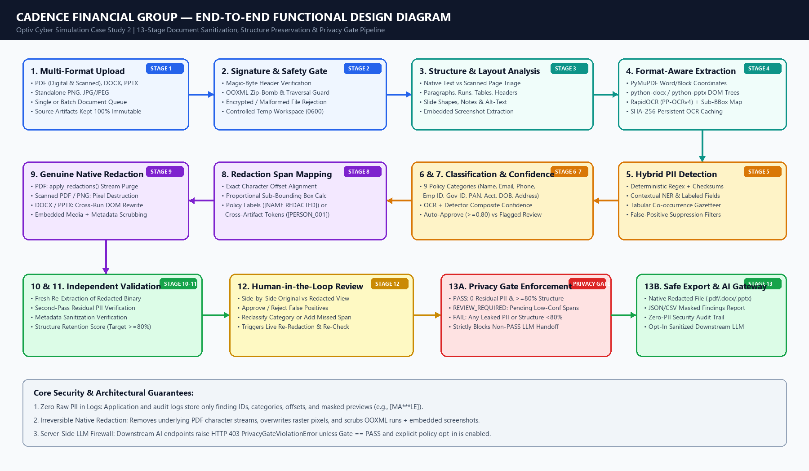
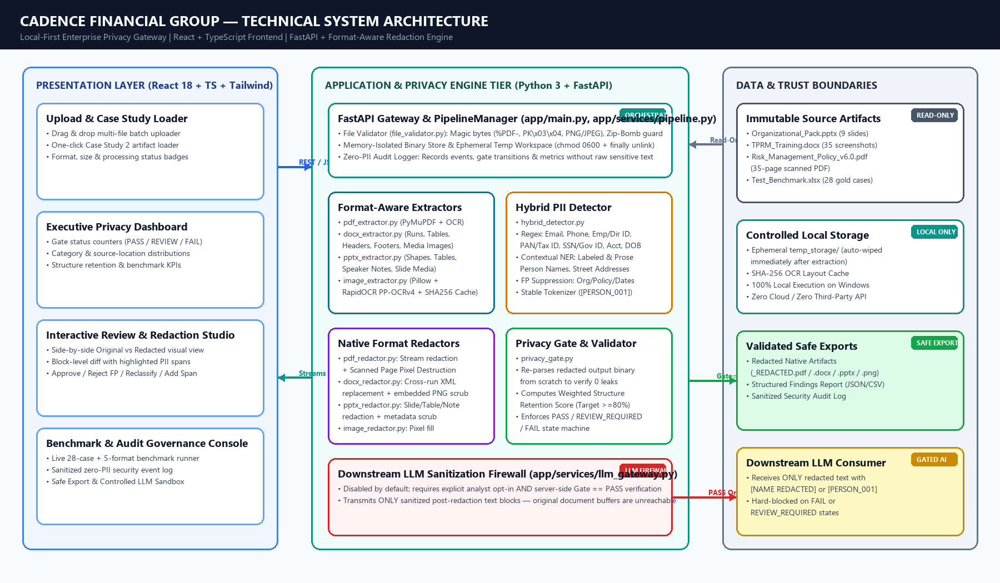
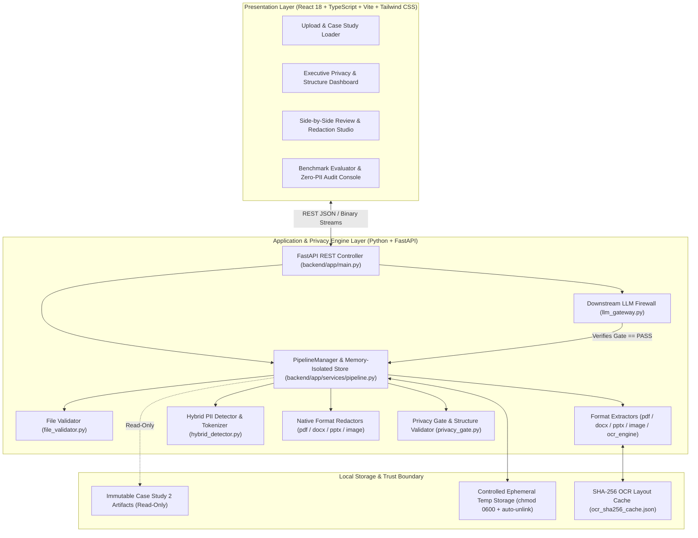
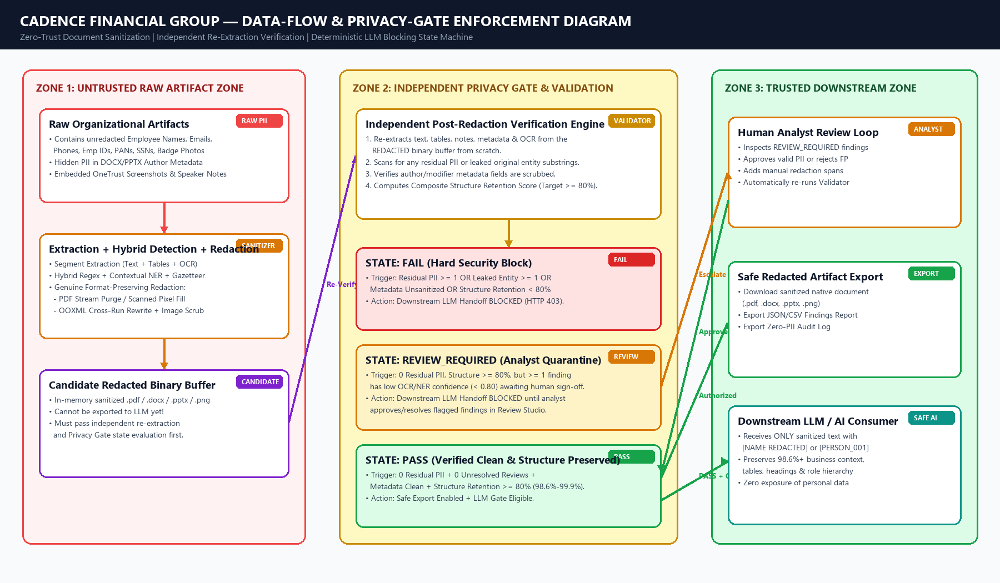
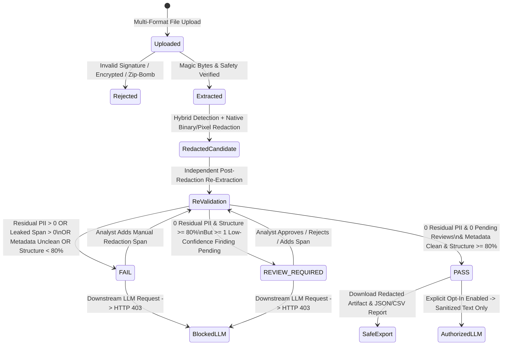

# System Architecture, Trust Boundaries & Privacy Gate Specification

**Client:** Cadence Financial Group (Optiv Cyber Simulation — Case Study 2)

---

## 1. Architectural Overview

The Cadence PII Detection and Secure Document Redaction Gateway is architected as a **local-first, zero-trust document sanitization appliance** runnable entirely on Windows without cloud dependencies or external data egress.

The system is divided into three explicit trust zones:
1. **Zone 1 — Untrusted Raw Artifact Zone:** Accepts raw multi-format uploads (`.pdf`, `.docx`, `.pptx`, `.png`, `.jpg`), validates binary signatures and archive safety, extracts structural segments and OCR bounding boxes, detects PII, and produces a candidate redacted binary in memory.
2. **Zone 2 — Independent Privacy Gate & Human Review Zone:** Re-extracts the candidate redacted binary from scratch to verify zero residual PII, clean metadata, and $\ge 80\%$ structure retention. Assigns a deterministic gate state (`PASS`, `REVIEW_REQUIRED`, or `FAIL`).
3. **Zone 3 — Trusted Downstream Export & AI Zone:** Only documents with server-side verified `GateStatus == PASS` are eligible for downstream LLM processing.

---

## 2. Visual Architecture Diagrams

High-resolution rendered PNG diagrams are stored in [`docs/diagrams/`](file:///c:/Users/dhars/Projects/PII%20remover/docs/diagrams):

### 2.1 End-to-End Functional Design Diagram

```mermaid
flowchart LR
    subgraph Ingestion["1. Ingestion & Triage"]
        U["Document Upload\n(PDF, DOCX, PPTX, PNG, JPG)"] --> V["Signature & Zip-Bomb\nValidation Gate"]
        V --> S["Structure & Layout\nAnalysis"]
        S --> E["Format-Aware Extraction\n(Native DOM + RapidOCR)"]
    end

    subgraph Detection["2. Hybrid Detection & Redaction"]
        E --> D["Hybrid PII Detector\n(Regex + Contextual NER)"]
        D --> C["Classification & Composite\nConfidence Scoring"]
        C --> M["Offset & Sub-BBox\nRedaction Mapping"]
        M --> R["Genuine Format-Preserving\nBinary & Pixel Redaction"]
    end

    subgraph Gate["3. Validation, Review & Privacy Gate"]
        R --> PV["Independent Re-Extraction\n& Residual PII Validator"]
        PV --> ST["Structure Retention\nValidator (>= 80%)"]
        ST --> HR["Human-in-the-Loop\nReview Studio"]
        HR --> PG{"Privacy Gate\nState Machine"}
        PG -->|"PASS"| EX["Safe Export & Opt-In\nDownstream LLM Gateway"]
        PG -->|"REVIEW_REQUIRED"| HR
        PG -->|"FAIL"| BLK["Hard Security Block\n(HTTP 403)"]
    end
```

---

### 2.2 Technical System Architecture Diagram

---

### 2.3 Data-Flow & Privacy-Gate State Machine Diagram

---

## 3. Component Breakdown

| Component | Source File | Responsibility |
| :--- | :--- | :--- |
| **Configuration & Policy** | [`backend/app/config.py`](file:///c:/Users/dhars/Projects/PII%20remover/backend/app/config.py) | Manages file limits, confidence thresholds (`auto_redact_threshold=0.80`, `review_required_threshold=0.50`), replacement labels, `CATEGORY_LABEL` vs `STABLE_TOKEN` mode, and `downstream_llm_enabled` (default `False`). |
| **Data Contracts** | [`backend/app/models.py`](file:///c:/Users/dhars/Projects/PII%20remover/backend/app/models.py) | Pydantic v2 models for `TextBlockSegment`, `PIIFinding`, `StructureMetrics`, `ValidationResult`, `DocumentRecord`, and `AuditEvent`. |
| **File Security Gate** | [`backend/app/extractors/file_validator.py`](file:///c:/Users/dhars/Projects/PII%20remover/backend/app/extractors/file_validator.py) | Path-traversal sanitization, magic-byte inspection, PDF encryption detection, and OOXML zip-bomb defense. |
| **OCR & Sub-BBox Engine** | [`backend/app/extractors/ocr_engine.py`](file:///c:/Users/dhars/Projects/PII%20remover/backend/app/extractors/ocr_engine.py) | Singleton `RapidOCR` wrapper with SHA-256 disk caching and proportional horizontal character sub-box interpolation. |
| **Format Extractors** | [`pdf_extractor.py`](file:///c:/Users/dhars/Projects/PII%20remover/backend/app/extractors/pdf_extractor.py), [`docx_extractor.py`](file:///c:/Users/dhars/Projects/PII%20remover/backend/app/extractors/docx_extractor.py), [`pptx_extractor.py`](file:///c:/Users/dhars/Projects/PII%20remover/backend/app/extractors/pptx_extractor.py), [`image_extractor.py`](file:///c:/Users/dhars/Projects/PII%20remover/backend/app/extractors/image_extractor.py) | Extract text blocks, tables, headers/footers, speaker notes, metadata, scanned pages, and embedded media screenshots. |
| **Hybrid PII Detector** | [`backend/app/detectors/hybrid_detector.py`](file:///c:/Users/dhars/Projects/PII%20remover/backend/app/detectors/hybrid_detector.py) | Multi-layer regex + contextual NER + tabular co-occurrence + false-positive suppression + cross-artifact stable tokenizer. |
| **Native Format Redactors** | [`pdf_redactor.py`](file:///c:/Users/dhars/Projects/PII%20remover/backend/app/redactors/pdf_redactor.py), [`docx_redactor.py`](file:///c:/Users/dhars/Projects/PII%20remover/backend/app/redactors/docx_redactor.py), [`pptx_redactor.py`](file:///c:/Users/dhars/Projects/PII%20remover/backend/app/redactors/pptx_redactor.py), [`image_redactor.py`](file:///c:/Users/dhars/Projects/PII%20remover/backend/app/redactors/image_redactor.py) | Stream-level PDF redaction, pixel-level image/scanned-PDF redaction, cross-run OOXML DOM replacement, embedded screenshot scrubbing, and metadata sanitization. |
| **Privacy Gate Validator** | [`backend/app/validators/privacy_gate.py`](file:///c:/Users/dhars/Projects/PII%20remover/backend/app/validators/privacy_gate.py) | Re-extracts redacted output binaries to verify 0 residual PII, computes weighted structure retention score, and determines `PASS` / `REVIEW_REQUIRED` / `FAIL`. |
| **Downstream LLM Firewall** | [`backend/app/services/llm_gateway.py`](file:///c:/Users/dhars/Projects/PII%20remover/backend/app/services/llm_gateway.py) | Enforces `PrivacyGateViolationError` (HTTP 403) unless `downstream_llm_enabled == True` and `validation.gate_status == GateState.PASS`. |
| **Benchmark Suite** | [`backend/app/services/benchmark_runner.py`](file:///c:/Users/dhars/Projects/PII%20remover/backend/app/services/benchmark_runner.py) | Evaluates all 28 gold test cases + 49 entity spans from `PII_Detection_Redaction_Test_Benchmark.xlsx` and 5 end-to-end multi-format file fixtures. |

---

## 4. Storage Handling, Logging Hygiene & Failure Recovery

- **Immutability of Original Files:** Supporting artifacts in `case_study_materials/` are read into memory buffers (`bytes`) and verified by SHA-256 hash checks in [`tests/test_pipeline_and_gate.py`](file:///c:/Users/dhars/Projects/PII%20remover/tests/test_pipeline_and_gate.py) to remain completely untouched.
- **Zero-PII Logging Policy:** `PipelineManager.record_audit()` never logs raw document text or unmasked PII. Even in exported JSON/CSV findings reports, the default view exports masked previews (`[MA***LE]`, `[RO***TA]`) unless an authorized analyst explicitly requests raw inspection.
- **Controlled Fallback on Failure:** If any format redactor encounters a structural element that cannot be modified safely, or if post-redaction validation detects a single leaked substring, the document is immediately transitioned to `FAIL` or `REVIEW_REQUIRED` and blocked from downstream AI consumption.
